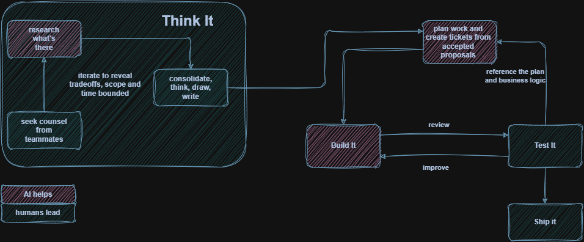

_It has been over two years since I last wrote a post, so be kind if you happen to make it onto this page. I wrote this essay on a whim as part of [this The Pragmatic Engineer essay challenge](https://blog.pragmaticengineer.com/how-software-engineering-is-changing-an-essay-challenge/) originally submitted on October 3rd, 2026. It was therapeutic, and got me back to doing something I enjoy. I hope it's worth your time, and thank you :)_

It had been well over a decade between when I last wrote a SQL query on a piece of paper and first argued with *Claude's* Opus 4.6 about its own queries. It was about how wrong the validation query an agent was writing for a pipeline was. I’ve had many disagreements with the (presumably French) robot, and most of them are centered on its lack of deep understanding for why the code being written exists when reviewing its decision chains. Sometimes, I’ll make a persisting `/artifact` if I know it’s something that we shall be chatting about in future sessions. But more times than not, I get to code tracing and the old reliable – pen and paper. To think. One could say it’s a skill issue (no pun intended), but there’s more nuance than that. One simply doesn’t build a personal assistant off the history of a series of tasks and no understanding of its engineer.

As an ESL speaker, I learned a lot of technical concepts the hard way with no translation to hold on to. There was no “hello world” because my journey into engineering was not traditional. I had to figure out how to use the right phrases in English to know how to do things like add up numbers or break up a piece of text in bulk. This led me to hello Excel\! I remember taking a class in what used to be called an Internet Cafe; a place people would pay to be in and log into the internet in timed sessions back when personal internet access was a luxury good. My class was in the main hospital campus in my home town because they had a big lab space for it. That class is my first memory of internalizing the word “aggregate”.

By the time I had worked in different jobs to get to the beginnings of a technical career, data analytics became my chosen path. It informed most of my learning habits – the roles that became my entry point into engineering. The first half decade was spent with accountants and economists. They *love* Excel, STATA, and SPSS. If you sent anything to an accountant in the 2010s that wasn’t in an Excel document, they wouldn’t know what to do with it to input data into their systems. Likewise health economists in my path and their love for statistical significance meant understanding the impact of any hypothesis, descriptive statistics, modeling, and visualization results I computed. This intellectual growth spurt came with a masters degree in applied economics and a honed questioning skill. Checking my work to make sure that not only did the diagram look pretty, it made sense; the data transformation and feature engineering was not convoluted, and all the decisions and logic between the input and output data could be explained.

All of these experiences shaped how I approached applying engineering concepts when I finally got my first strictly software building role at the turn of the COVID pandemic. Because of my reps in applied economics, statistical programming, and data analytics and ops, data engineering was the next logical lane. It is a technical space where people at the intersection of domain data understanding and software engineering thrive. To an everyday user, being a developer was mostly connoted with the web and user experience outcomes. When the page doesn’t load or the button doesn’t work, that’s an incident to a software engineer. If a page loads too slowly that the customer support engineers and QA folks reach out to your team, then one can sell a refactor. But data is a bit different. It’s not about the function of the experience, it’s really about the content and outcomes of it.

Without agents and chatbots, that meant getting really good at translating business logic into an expected output. If there was a pipeline to be written, the easier part was getting the code in place. Yes, there was a bit of google and old school (they’ve re-branded) stack overflow here, and copying over existing blocks of reusable code there. Once the code and some unit tests were in, making sure the data in – data out completeness was good becomes important. Not only should the pipeline work, but there exist counters and validations to help track trends, some anomaly detection once enough of the pipeline has run over time, and tweaks along the way as logic changes and data grows. By the time I could ask Claude to review a PR for me or validate a pipeline, there was a lot of baggage it didn’t know how to account for to meet the standard of *lgtm. My* standard. An even higher and more nuanced bar when it comes to transforming events into meaning*.*

Take a place like the one formally known as Twitter, for example. A data engineer there probably thinks about how to balance storing the latest tweets versus the most relevant ones for different views. Or prioritizing users that had more followers so their data is cached because everyone wants to see it all the time. One might also have to decide how to log each event – a like, a quote, a retweet, a view; such that your downstream sister team (or org, fka Twitter is big) can build pipelines that compute [MAUs](https://www.investopedia.com/terms/m/monthly-active-user-mau.asp). And beyond that, making algorithms likely depends on the optimal storage and segmentation of all these corpus. User experiences become a self feeding cycle based on user inputs and that introduces some machine learning into the mix, a building block of what has ended up becoming artificial intelligence as we know and use it today – favorite app or not.

Thanks to the pioneers who built a lot of these systems, they shared the battle scars and learnings in the form of books, talks, blogs, etc. That knowledge has now made it into AI models and been baked into skills and plugins that reduce the amount of time spent thinking about how to solve the problem. There are at this point in time, fewer new problems in technology for companies like mine that have existed for a while. If the technical riddle has been solved before, most time is spent figuring out how not to reinvent the wheel and economies of scale. For instance, in my current team, we have been oscillating between problems that require near real time solutions versus those that can be solved with batch processes and outputs. Traditionally there have not been a lot of data teams at Spotify because of the org sizes and needs. Before the specific engineering sect existed, a lot of back-end engineers swallowed the data work because services produce or ingest information to fulfill a function. That puts most of my days as one of those data people on either end of a full-stack service (or cluster of micro services) that me and my teammates build.

I’m surrounded by mostly back-end engineers and a learner friendly culture where anyone can pick up a pipeline ticket. I myself get to do a lot of OG software engineering because of this openness. There is less of a barrier of entry because my teammates are not necessarily going to pick up [*Designing Data Intensive Applications*](https://www.oreilly.com/library/view/designing-data-intensive-applications/9781491903063/) to read from scratch before engaging with a big data adjacent ticket. All they need to do is guide *Claude* to code search other examples of pipelines or data heavy systems (most are now) and perhaps deploy @obra’s [superpower brainstorming skill](https://github.com/obra/superpowers) for ideas. The main challenge remains understanding the business logic and domain enough to catch when the robot is hallucinating, and when it is unnecessarily using lower level libraries instead of abstractions because they’re not known to the prompter. The code patterns out of such constructed PRs become a good gauge for observing the different types of engineers and what they focus on knowing and learning. Are they optimizing for reusability, concurrency, scale? Could the solution be overly reliant on current or nascent understanding of the business? How are they thinking about the extensibility of the system? All that and a bag of unknown chips.

A lot of engineers I’ve encountered geek out about the technical parts of the gig. For the data ones, they’ll wonder about the optimal data salting technique for optimizing storage or the best data store for machine learning model training inputs or how to hash data and track changes to optimize for a UI vs analytics use case – all great problems to solve the *how.* All questions I don’t find all that enticing to ask *Claudia* (the French AI’s sister). Now I might read the docs on a library and ask it to EL15, but that press of pen to paper still jolts me when it comes to wrestling with the *why*. I love the intersection of the domain system’s problem and the technical solution because my introduction into engineering was always centered on what is being stored, not how it’s being stored. Not *strings* and *boolean* *fields* or *array bytes*. More like: *why care about this person’s one click event vs counting them*? *Why count them at all vs knowing what threshold of the count is meaningful for what we’re tracking*? Those questions. Claude or Codex can’t tell me why I should qualify an event as meaningful. They can only follow me once I’ve figured it out. Once the pipeline is written, how it is audited is most interesting. In the same way how once you have users for your app, you then better understand what features to optimize for. That requires continuous learning. Now more than ever, it requires more investment than learning the code.

My current team presents many opportunities for a nosy Rosie to expand the bounds of their intellectual horizons. We are a good mix of data, web, and full-stack engineers, and enjoy yapping, which lends itself to a lot of knowledge sharing. We fill in each other’s gaps. We spend a lot of shared hours on Tuple talking through diagrams and context – sometimes with our product counterparts. I’m lucky to work with a product manager who likes to engage in technical discussions and likewise encourages us to share feedback about their requirements. It means we can come up with benchmarks together for validating things and *then* use that to start adding code and test it. Internalizing our potential user’s experience and product vision eventually inform our understanding of how one change in a system can have ripple effects for downstream users of the output in another – things one can only build over time like the reliability of a confidant (*The Golden Girls* knew what they were talking about here) or trusted assistant. And now we all have assistants we have to tune.

Imagine any lead role where we’ve come to be used to seeing the importance of personal assistants. A head coach of a team, a CEO, the mom and pop shop owner who has had the same worker for 20 years in a small town. They have built a relationship with their assistants based on trust, respect, and knowing each other’s quirks. It’s a sort of dance when you can anticipate what one needs or the questions they may ask while working to be effective at their job. The assistance is meant to take work off one’s plate so that the only thing they focus on is maximizing their abilities to deliver value. To do the things they are good at, maybe even excited to do. The coach’s assistant knows to block out the calendar so that if the coach’s wife stops by for lunch on the week of a tough match up, no one will interrupt it. They also know to book the coach’s wife a nice spa day on the last practice day so the Mrs. doesn’t distract the coach when the boss looks stressed. Each action should improve the situation, removing all the distractions and barriers, optimizing for efficiency and focus and ultimately building trust.

Part of optimizing AI usage for our product area has come with codifying our self-reliant quirks in code using shared skills, rules, and agents. Everyone – the intern, junior engineer, 10 year veteran web and front end engineer, mid career back-end folks and my data self – all came with our own standards, frameworks, and learning habits. Those of us who learned our domains the hard way, pre-AI, tend to have the strongest opinions about tech stacks, libraries, paradigms, and everything in between. When writing a data transformation heavy back-end service that was moving from a pipeline once, I used functional interfaces everywhere because the book [*Functional Programming in Scala*](https://www.manning.com/books/functional-programming-in-scala) was part of my learning journey. The first people to notice were the engineers who’d been writing code by hand since the last Obama administration. After a lot of back and forth, we settled on minimal functional programming, but kept a lot of the data-centric validation that I’ve carried with me from big data scars. Eventually with continually added skills and repo rules, it has gotten easier to catch each other’s habits and adapt to more people’s ways of learning.

A knowledge sharing contrast that became immediately apparent when AI became part of everyone’s workflows was how much our systems were being documented without being internalized. Engineers would need multiple reminders about logic in a barely month old service in discussions. My theory is the less code we “wrote”, the less we remembered. So our learning-by-repetition anchor went from *what we do* to *what we share with each other*. I for instance am verbose, and tend to write runbooks and documents that try to capture every nuance. That isn’t always helpful given most companies have started to expect more output with AI with the same amount of people doing more work. As one of my teammates who is very good at diagramming likes to remind me, “people don’t read”. So where there would have been more designated time for the code writing when planning, we started spending more time drawing things out and talking in diagrams. It allowed more people to actively participate and contribute to the system design because once that’s sound, the code is going to be auto-generated anyway. Now, it is faster to add documentation for the systems we are building once the code is in. The pictures and flow diagrams are helpful as well to explain logic – [mermaid](https://mermaid.js.org/) is really good at that. This all makes what we share to learn more accessible. Engineers can always revisit these artifacts to retain knowledge because of the product and technical syncing that was done upfront.

That *think it* stage as it used to be called a few years ago at Spotify is where *my line* is for what I preserve from outsourcing to any AI tool. A lot of my teammates work this way for the most part. We will use (mostly) *claude* as an investigative tool that combs through systems and shares information so we can then think through trade-offs and propose solutions. All the system design specs are discussed with humans. Whatever we build has to make sense for the problem we are solving. Once that feedback loop is done, I personally still write any artifacts produced from these explorations myself i.e. an RFC, a tech design, or this essay\! It is a skill I’m forever trying to refine as a non-native English user. Specifically, the ability to take a business problem and translate it into the technical approach and then rewind back to the system and product impacts is a trained muscle; and still a challenge for an AI tool to scoop up or reason about. Agents can sometimes output logical fallacies – going into deep dives and returning with self appointed rabbit hole insights that they think are *thee things to solve.* More times than not, these are circular arguments and conclusions made from an over-fitted vantage point. I try not to get sucked into those while engaging my brain in trade-offs.

After any proposals are reviewed, I offload admin tasks where I can live with the AI standard being different from mine. My favorite one in the beginning of the *build it* stage is a `/rfc-to-jira-tickets` skill I created that can be used by an agent to break down the researched and concluded upon proposal, figma diagrams, product briefs, and tech design document(s) into ticketed work engineers can pick up. My “assistant” can fiddle with JIRA ticket notes and reference links while I save a couple hours for my brain to focus on socializing the plan and answering questions when folks start picking up the work. One of my teammates even adapted it a step further to show a plan for how the code changes as its own artifact.

Some of our ways of working naturally start to influence each others’ and it has become baked into our interpersonal interactions and even how our managers plan the work. For instance, a primarily back-end engineer can be a tech lead for a project that touches all technical domains up to a UI feature. They will do their research, but also summon the rest of us to chat through anything ranging from whether or not to make a new back-end micro service to deciding on near real time vs batch updates to user action statuses. This sub-culture makes it a great team for interns and junior engineers because we allow and support each other to try working on domains we might not be completely comfortable in. If I’m spending my time creating and updating 30 tickets so that they have enough context for a junior engineer or a back-end engineer looking to try data work, we would never have time for the fun discussions about how and why to make certain choices or teach each other technical things when *Claude* doesn’t help. That’s what the artificially generated skills are for.

When there was a more formal push to make sure all engineers were keeping up with industry-wide AI developments, we made time to share tips, talk through what it means in establishing our standards, and which things we care to offload or not. We even established (shout out to Iris) an hour for code reviews daily because as the amount of generated code increased, so did the merge requests. While there is a risk of biasing towards the author’s explanation of a change, we win back context switching time where instead of pausing in between meetings and focus blocks to review every new PR, we are more mindful to expect our work reviews to be handled during a specific time of day. Review hour has become such a hit that sister teams sometimes join in to share interacting system changes they’re planning on making to get a more holistic feedback loop. There is even a variation of review hour every Wednesday. Instead of pull requests and clicking through code, we look at proposals and system design. We haven’t perfected the balance of all these new behaviors, but again, we stay adaptable.

On the human side, working for a company that allows access to AI resources has been a double-edged career trajectory sword. I went from a strictly data engineer and part time data science consultant to a mostly back-end, sometimes still data engineer. Every so often, I’ll do a CRUD endpoint ticket from scratch just to feel something and remember why we do things a certain way. While I’ve been able to use AI to accelerate technical T-shapedness, I miss some agency in fundamental tech stack choices. If you happen to work at a big enough company, at some point even before the AI boom, there is a practice of standardizing frameworks, tools, and libraries. As discussed earlier, most new problems in a contained environment eventually become solved. Companies even build custom tools that fit their problem space and centralize code so that there are less ways to do things. AI has accelerated how fast this choice reduction is introduced.

When I first joined Spotify, we mostly chose what programming languages and frameworks to use when writing pipelines. There was always [Scio](https://spotify.github.io/scio/), the Scala library built on top of Apache Beam and Google dataflow, that was created at a time when open source was behind the needs of the company. But if your team was far from event generation production data, you could write light weight workflows with Python, use BigQuery scheduled queries, and I promise I saw a cron job with a bash script directly dumping data from Salesforce via API once. In the last decade, data engineering [became the hottest data career path](https://www.newswire.com/news/data-science-job-market-shrinking-as-data-engineering-grows-21316582) with the explosion and maturity of internet use cases and over time, the [reduced cost of computing and storage](https://fred.stlouisfed.org/series/PCU334112334112). An influx of enterprise and open source solutions for processing the resulting big data more economically supervened.

For us, Scio has persevered as the data engineering [Golden Path](https://engineering.atspotify.com/2020/8/how-we-use-golden-paths-to-solve-fragmentation-in-our-software-ecosystem) along with two other options that platform teams maintain and strongly encourage teams to use. It makes fleet updates and tool additions easier to implement at a higher velocity and larger scale if everyone is using the same things. Any isolated setups are even more discouraged because very few people, if any, can help with deployment issues, upgrades, security vulnerability management, and everything in between. Ultimately, all the code ended up in monorepos and that paved the way for easier AI integration with developer tools and experience across the company. Now those pipeline writing agents can tighten up their implementation plans as our march towards more of the same tech stacks intensifies.

I don’t concretely know what our AI trek means long term. If anything it underscores the importance of focusing on the product more than its implementation while knowing your engineering fundamentals. Of weighing the trade-offs on our scoping choices on the problem, and less on the tools available to us. And yes – I miss needing to know why we picked the languages and tools that keep getting abstracted away. Why did the data builders prefer Python’s readability and scripting over Java’s enterprise influenced libraries? Stuff like that is becoming optional, akin to a history lesson, for developers to dig into. Sometimes it scares me that the next version of developer will have less fundamental understanding of what they’re using to build, but also maybe it was already happening anyway.

It was only three years ago when I learned the phrase “lower level” in a technical context. As in *lower level library* or *lower level functions*, from a data engineer teammate who wondered why I knew to use `bq cp` in the [bq-cli reference](https://docs.cloud.google.com/bigquery/docs/reference/bq-cli-reference) instead of the UI or how to tune a dataflow job because it was going too slow. He asked where did you learn all this? The hard way. That’s why I don’t want to forget it. Even though non-human generated code has freed up my time, I still enjoy the exercise of parsing my understanding of the technical domain I work in beyond the abstractions. Because like [Stephen King once wrote](https://stephenking.com/works/nonfiction/on-writing-a-memoir-of-the-craft.html) “If you want to be a writer, you must do two things above all others: read a lot and write a lot”. Reading makes writers. And writing to process what I’ve read, or in this case typing, is how *I* learn. As for micromanaging logic validations in my [CODA](https://coda.io/) notes while talking to agents, it’s still a journey.

Don’t get me wrong, a lot of my agent assistants have gotten better at sensing patterns and trends – even inferring deep business logic that to the untrained eye may appear as strong institutional knowledge. But we’re not there yet. I’m sure if I were to invest time [building a second brain](https://www.buildingasecondbrain.com/) and feeding it as context to AI, me, *claude, claudia*, and all their cousins may eventually get there. I am not trying to race against time to ingest and remember everything. Offloading all this nuance, verbose, multilingual and multicultural, system biased way of thinking is a lot to write down. Even for me. And remember, people (myself sometimes included) don’t read\! But as long as they learn – and I *am* surrounded by some great learners, we should be OK navigating this ever-changing engineering landscape. All while me and my frenemy duke it out over anti-pattern validation queries.

The last edit of this essay was made while enjoying the return of NCAA women's basketball, so in the spirit of celebration - happy WBB season to all who partake, and go Sarah Strong and the UConn Huskies :smiling_face_with_three_hearts:

